<!--
  Editable source of docs/NyaySutra_Project_Documentation.pdf.
  Build the PDF with:  python docs/project_documentation/build_pdf.py
  Status chips: Implemented Partial
                Planned Needs verification
-->

Project documentation · prototype review

<h1 class="cover-title">NyaySutra: Complete Project Documentation</h1>

Features, Technology Stack, Architecture, Data Sources and Workflow

An AI-assisted legal research workspace for Indian advocates — answers grounded in official bare acts and the lawyer's own case files, with numbered citations that can be checked.

<table class="cover-meta">
<tr><td>Document purpose</td><td>Explain the project, in plain English, to mentors and reviewers who are not software or AI specialists.</td></tr>
<tr><td>Prototype status</td><td>Working prototype, run on a single computer (127.0.0.1) and connected to a Supabase cloud project in the Mumbai region. Not deployed for public use.</td></tr>
<tr><td>Based on</td><td>The code in the repository <em>SwarangiK-21/NyaySutra-AI</em> (branch <em>main</em>, commit 8e63731 plus one uncommitted dashboard fix), the live Supabase project and the running application, inspected on 25 October 2026.</td></tr>
<tr><td>Student / team</td><td class="fill">[ To be filled in — not recorded in the repository ]</td></tr>
<tr><td>Mentor</td><td class="fill">[ To be filled in ]</td></tr>
<tr><td>Institution / course</td><td class="fill">[ To be filled in ]</td></tr>
</table>

How to read the status labels in this document

Implemented found in the code and seen working &nbsp; Partial works with clear limits &nbsp; Planned not built yet &nbsp; Needs verification could not be confirmed

# 1. Executive Summary

**NyaySutra** (from *nyaya*, justice, and *sutra*, a thread or formula) is a prototype **legal research assistant for Indian advocates**. A lawyer can keep each matter (case) in one place, upload the case papers, and ask questions in plain language. NyaySutra searches the lawyer's own documents and a library of **official bare acts** (the exact text of Indian laws, downloaded from the Government's *India Code* website), and then writes an answer in which **every statement points to a numbered source** that the lawyer can open and check.

**The problem it addresses.** Legal research means finding the right section of the right Act, reading long judgments and case papers, and connecting the facts of a matter to the law. This takes time, legal language is hard for juniors and clients, and an ordinary AI chatbot can invent sections or case names that do not exist. NyaySutra's design goal is the opposite: *answer only from sources that can be shown*, and say clearly when the sources do not cover the question.

**Who may benefit.** Practising advocates and junior lawyers (the main persona, called **Lawyer** in the app), law firms or chambers (an **Administrator** manages people and settings), and — for the public awareness pages only — members of the public.

**What the current prototype can do** (all verified in the running application):

| Area | What a user can do today |
|---|---|
| Legal research chat | Ask questions in English, Hindi or Marathi (typed, or spoken through the browser); get a cited answer with a Sources panel and an automatic citation check. |
| Case files | Create a matter, upload papers (PDF including scanned PDFs, Word, Excel, CSV, PowerPoint, OpenDocument, RTF, text, photos), and have them read, indexed and summarised. |
| Law library | 31 bare acts are indexed (29 central, 1 Maharashtra, 1 Karnataka), plus 3 sample judgments and 22 drafting templates; any further central or state act can be searched on India Code and added in one click. |
| Drafting | Generate drafts (plaint, written statement, bail applications, legal notices, Section 138 NI Act demand notice and others) that keep unknown facts as placeholders; review, approve and export to Word or PDF. |
| Planning | A calendar for hearings, deadlines and tasks, with reminders sent by the server even when the app is closed. |
| Tools | Limitation-period calculator, case-number lookup helpers, legal-news headlines, state-wise legal awareness pages. |
| Accounts & security | Public sign-up (always as a Lawyer), e-mail verification, two-step verification, roles, per-case access, database-level row security, audit log. |

**Honest summary of maturity.** This is a **working prototype**, not a production service. It runs on one computer, the law library covers a curated set of acts rather than all of Indian law, the AI can still make mistakes (which the citation check tries to catch, not guarantee), and several protections that a production legal service needs — independent security testing, malware scanning, hosting, backups and monitoring — are not in place yet. Chapter 17 lists what is done, partial and planned.

# 2. Problem Statement

Indian legal research has a few practical difficulties that this project tries to address. These are general observations, not measured claims about the legal system.

1. **Finding the right provision.** Laws are long and are frequently amended; criminal law in particular moved from the IPC, CrPC and Evidence Act to the BNS, BNSS and BSA on 1 July 2024, so a lawyer often has to check both regimes. Each State also has its own Acts (for example rent control, land revenue or police Acts), so the "right" law depends on where the matter is.
2. **Understanding legal language.** Bare acts and judgments are written in technical English. Juniors, clients and non-specialist readers need help to understand what a provision means for a particular set of facts.
3. **Locating related judgments.** Judgments are long, and the relevant reasoning is usually a few paragraphs inside a document of many pages.
4. **Reviewing many documents for one matter.** A single case can have agreements, notices, FIRs, orders and correspondence — sometimes scanned, sometimes in Hindi or Marathi — and the lawyer has to keep the facts straight across all of them.
5. **The risk of general AI chatbots.** A general chatbot answers from its memory of the internet. It can be outdated, can mix up jurisdictions, and can confidently invent section numbers or case names ("hallucinations"). For legal work an invented citation is worse than no answer.

NyaySutra's response is to (a) keep the lawyer's matter and documents together, (b) answer only from retrieved, numbered sources, (c) check those citations automatically, and (d) make it easy to open the original text.

# 3. Project Objectives and Scope

## 3.1 Objectives

- Give lawyers **cited, checkable answers** grounded in official statute text and their own case papers.
- Make long and multilingual documents (including scanned ones) **searchable and summarisable**.
- Help with **first drafts** of routine legal documents without inventing facts.
- Help lawyers **track hearings and deadlines** across matters.
- Protect confidential client material with **accounts, roles, per-case access and database-level security**.

## 3.2 Intended users

| Persona | What they can do |
|---|---|
| **Lawyer** (anyone who registers and verifies their e-mail) | Create and work on their own matters, research, draft, use the calendar and history, add official acts to the library. |
| **Administrator** (appointed by another administrator, never self-chosen) | Everything a lawyer can do, plus manage users and roles, invitations, organisation settings, integrations and the activity (audit) log. Sees the organisation's list of matters but not their contents unless added to the case. |
| **Visitor** (not signed in) | Read the bare acts, the India Code catalogue, legal-awareness pages and the limitation calculator. |

Earlier versions had *Client* and *Security auditor* roles; they were removed in October 2026 (database migration 07).

## 3.3 Current scope

- **Implemented:** everything described in Chapter 4 with an Implemented label.
- **Geography:** the bare-act library is mainly **central law** plus one Maharashtra and one Karnataka act; any of the 36 States/Union Territories' acts can be **looked up** on India Code and added, but they are not pre-loaded. Court-specific helpers (case search links, drafting forum rules) are written for the **Supreme Court, Bombay High Court, Maharashtra district courts and Maharashtra police** only. Legal-awareness content covers central law and Maharashtra.
- **Languages:** interface in English and Hindi; answers in English, Hindi or Marathi; OCR reads English, Hindi and Marathi.
- **Deployment:** runs on one computer; not hosted on the internet.

## 3.4 Out of scope / planned (not built)

- Public hosting, backups, monitoring and a formal security audit (Chapter 17).
- Automatic access to court case-status systems (they require CAPTCHA and offer no public API — the app opens the official page instead).
- A licensed case-law database (Indian Kanoon or others) — only three sample judgments are included.
- Mobile apps; payments; client-facing portal.

# 4. Complete Feature-by-Feature Explanation

Each feature below follows the same pattern: *what it does → why it is needed → how a user uses it → what happens behind the scenes → technology and data → an example → status*.

## 4.1 Accounts, sign-in and two-step verification Implemented

- **What:** Personal accounts with e-mail verification, password rules, password reset, two-step verification (a 6-digit code from an authenticator app such as Google Authenticator), one-time recovery codes, and a list of signed-in devices that can be signed out.
- **Why:** Case papers are confidential; each lawyer must see only their own matters.
- **How to use:** *Create an account* → open the verification e-mail → sign in → scan the QR code with an authenticator app → type the 6-digit code → save the recovery codes.
- **Behind the scenes:** Passwords and e-mail links are handled by **Supabase Auth**. The NyaySutra server keeps the sign-in tokens itself (encrypted in Supabase Vault) and gives the browser only an opaque cookie that scripts cannot read (*HttpOnly*). Sessions expire after 60 minutes of inactivity or 12 hours in total. After 5 wrong passwords the account is locked for 15 minutes. New accounts are always **Lawyer**; only an administrator can make someone an administrator.
- **Example:** A junior advocate registers with her chamber e-mail, verifies it and is asked for an authenticator code before she can see any case data.
- **Note:** Two-step verification is mandatory for both personas. Supabase's "leaked password protection" option is currently switched off (see Chapter 12).

## 4.2 Case files (matters) Implemented

- **What:** A record per matter: parties and their roles, case type, court, State/district, case, filing, CNR and FIR numbers, filing date, next hearing date, status, Acts relied on and a facts summary. Tabs: *Overview, Documents, Provisions, Notes & orders, People*.
- **Why:** Research is more accurate when the assistant knows the facts and papers of the matter.
- **How to use:** *Case Files → + New case* → fill the form (fields adapt: e.g. police-station appears for criminal matters) → *Create* (or *Save as draft*). Add colleagues under *People*.
- **Behind the scenes:** The creator becomes the case **owner**. Access is stored in `case_members`; the server checks it on every request and the database enforces it again with row-level security.
- **Example:** "Asha Rao v. Ramesh Kumar" — civil, Pune, next hearing 3 November.

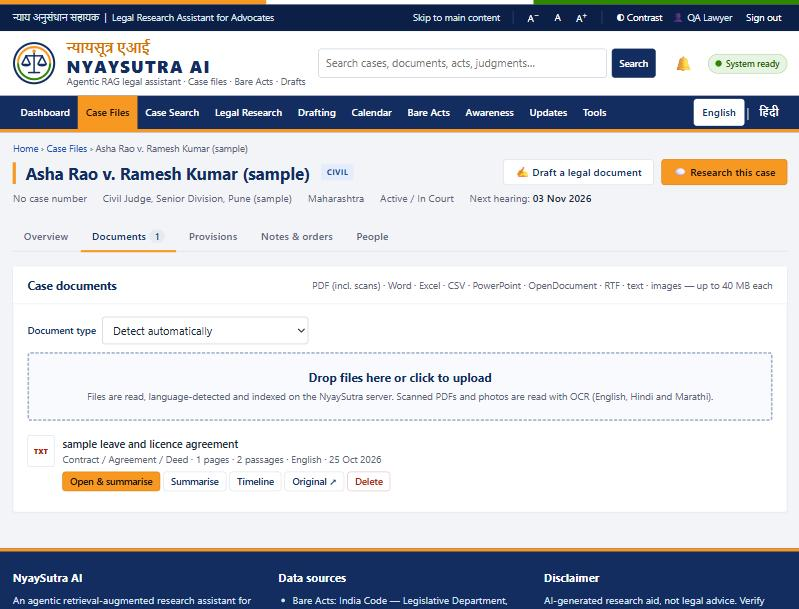

## 4.3 Document upload and reading (including OCR) Implemented

- **What:** Upload one or many files to a case. Accepted: PDF (including **scanned PDFs**), Word (DOC/DOCX), Excel (XLSX/XLS), CSV/TSV, PowerPoint (PPTX), OpenDocument (ODT/ODS), RTF, text/Markdown and images (PNG, JPG, TIFF, WEBP, BMP, GIF), up to 40 MB each.
- **Why:** Case papers come in every format; many are scans or phone photos.
- **How to use:** Case → *Documents* → drag files onto the box (or *Upload & summarise* for several at once with progress).
- **Behind the scenes:** (1) safety checks — the file's content must match its type (a renamed program is refused), PDFs with JavaScript or embedded files and Office files with macros, embedded objects or external links are refused; (2) the file is stored in a **private Supabase Storage bucket**; (3) a background worker extracts the text — scanned pages are read with **OCR** (optical character recognition: turning a picture of text into text) using RapidOCR, which reads English and, with a second model, Hindi and Marathi; (4) the text is split into passages, indexed and becomes searchable. Uncertain OCR words are marked `[?word]` rather than guessed. A quality check warns about blank pages, garbled text or missing page numbers.
- **Example:** A 36-page scanned PDF uploaded during testing was read in about 9½ minutes (average OCR confidence 76%), after which its contents were searchable.
- **Limits:** OCR runs on the computer's processor (roughly 5–20 seconds per scanned page); at most 60 scanned pages per file by default; handwriting and faint scans give poorer results. Legacy `.doc` files need an extra tool (*antiword*) that is not installed.

## 4.4 Legal research chat Implemented

- **What:** The main feature. Ask a legal question about a matter or about the law in general; receive an answer with numbered citations.
- **Why:** To get to the relevant law and facts quickly, with proof.
- **How to use:** *Legal Research* → (optional) open **☰ Matters** to choose the matter, the search scope (*Case + Library*, *Case files only*, *Law library only*) and the **jurisdiction** (central law plus one State) → type or speak the question → *Send*. Open **Sources** to see every passage used; click a [1]-style citation to open the passage and the original PDF page.
- **Behind the scenes:** the "research agent" described in Chapter 8: screening → planning → search (exact section lookup + keyword + meaning search, filtered by jurisdiction and access) → re-ranking → answer by the large language model using *only* the numbered passages → citation audit → output check. Progress is streamed live, so the user sees "Searching…", then the answer as it is written.
- **Example (seen in testing):** *"Can my client recover the security deposit, and within what time must she file a suit?"* — the answer cited the Limitation Act, 1963 (Schedule, Article 70) and CPC Order XIV Rule 1 from the official library; the citation audit flagged one point ("Article 70 of the Constitution") that was not in the sources — the kind of slip the audit exists to catch.

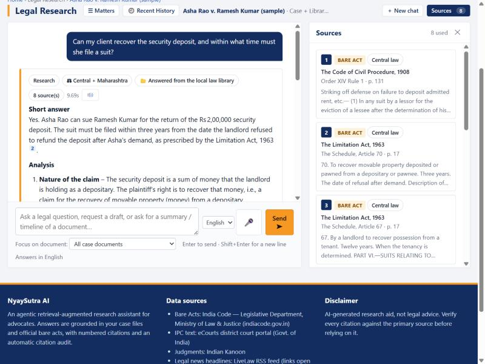

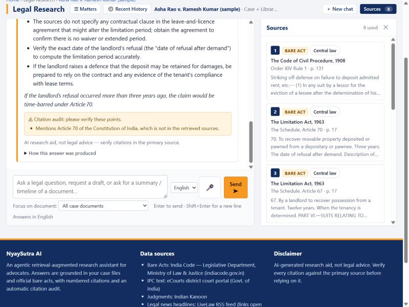

## 4.5 Source citations and citation checking Implemented

- **What:** Every answer lists its sources; each claim carries a [n] marker linked to a passage; an automatic **citation audit** reports whether the answer is fully supported.
- **How it works:** The model is instructed to use only the numbered sources. After it answers, code checks that every [n] exists, looks for section numbers, case names and dates that do not appear in the sources, and asks a smaller model to double-check support. Unsupported points are listed in an amber box; fully supported answers show a green tick. Statutes are labelled *Central law* or with the State's name.
- **Limit:** The audit reduces but does not eliminate errors: it can miss a subtle misreading of a correct source, and it cannot tell whether a source is outdated (Chapter 13).

## 4.6 Recent History Implemented

- **What:** A drawer on the Legal Research page listing the user's own past **conversations** (from every matter) and **searches**; one click reopens them. Hidden by default so the chat has the full width.
- **Behind the scenes:** Chats and searches are stored per user (`chats`, `messages`, `search_history`) and protected so that only their owner can read them. An administrator can set a retention period after which old conversations and searches are deleted.

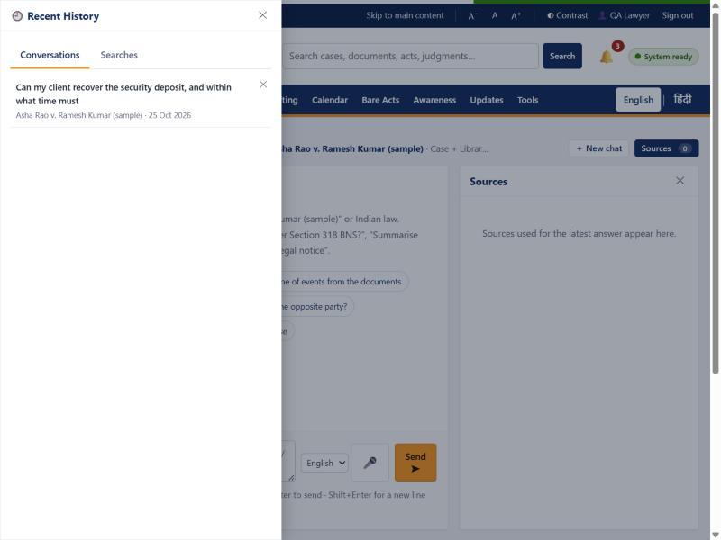

## 4.7 Law library: bare acts, judgments and the All-India catalogue Implemented Partial coverage

- **What:** (a) The indexed library — 31 bare acts, 3 sample judgments, 22 drafting templates; an instant section lookup ("Section 138 NI Act") without AI; (b) the **All-India catalogue** — a live search of India Code for Central Acts and for any of the 36 States/UTs, with *Add to research library*.
- **How to use:** *Bare Acts* → *Bare Acts* tab to look up a section; *All-India catalogue* tab → choose a State → optional words → *Search* → *Add to research library* on the act you need. It becomes searchable after indexing (about a minute).
- **Behind the scenes:** The catalogue calls India Code's public REST interface (an API — a door through which programs can ask another system for data). Imported acts are downloaded only from indiacode.gov.in, checked to be real PDFs, tagged with their jurisdiction and indexed. A daily check notices when India Code updates the record of an act already in the library.
- **Coverage, honestly:** 29 central acts (e.g. BNS, BNSS, BSA, CPC, Contract Act, Limitation Act, NI Act, Constitution, Consumer Protection Act, Hindu Marriage Act, POCSO, IT Act, Motor Vehicles Act), the repealed IPC (kept for pending matters), the Maharashtra Land Revenue Code and the Karnataka Rent Act. The old CrPC and Evidence Act are *not* included (no current official consolidation was found). Judgments: only three Supreme Court judgments downloaded manually from Indian Kanoon as samples.

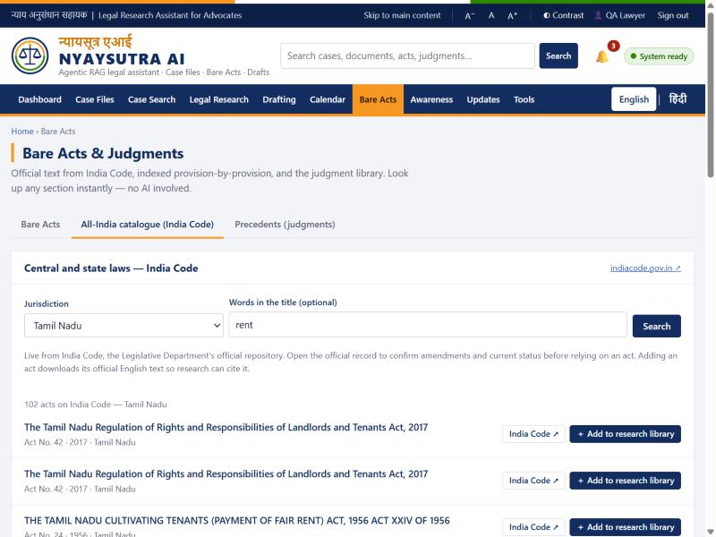

## 4.8 Document analysis, translation and summaries Implemented

- **What:** For any case document: view original and extracted text, translate it into English, and produce structured summaries (English, Hindi, Marathi); in chat, ask for a summary, timeline, issues, parties or arguments of one document.
- **Behind the scenes:** These run as background jobs. The user is asked for consent before document text is sent to the language model. Very long documents are read in parts and combined.

## 4.9 Drafting studio and legal notices Implemented

- **What:** 14 document types (plaint, written statement, general petition, interlocutory application, regular and anticipatory bail, reply, affidavit, written submissions, representation, consumer complaint, general legal notice, Section 138 NI Act demand notice, Section 80 CPC notice) and 9 forum settings (Supreme Court, Bombay High Court, district civil and criminal courts, Family Court, District and State Consumer Commissions, Maharashtra revenue authorities, and "not filed").
- **How to use:** *Drafting* → choose case, type, forum, style and language → (optional) template, base draft, supporting documents, known facts, instructions → *Generate*. The editor shows the draft beside a preview, with tabs for *Information needed*, *Facts used*, *Law sources*, *Requirements to confirm*, *Versions* and *Review*.
- **Behind the scenes:** Facts are extracted from the chosen documents with their origin marked (file, user, case). Anything unknown stays as a **[●] placeholder** — nothing is invented. A draft cannot be approved while placeholders remain; only an approved version is exported without the "DRAFT" label.

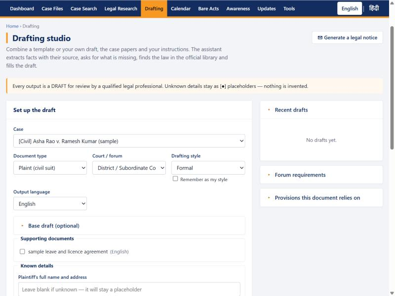

## 4.10 Applicable provisions Implemented

Suggests acts and sections that may apply to a matter; each suggestion is **checked against the library** ("verified in library" or "not found") and the lawyer accepts, rejects or edits it.

## 4.11 Calendar, hearings and reminders Implemented E-mail not configured

- **What:** Month / week / day views; entries for court hearings, deadlines, follow-ups, document submissions, meetings and tasks, each with notes, linked matter, date, time, priority and reminders (at the time, 1 hour, on the day, 1 day or 7 days before). Complete, reopen, reschedule, cancel, delete. Next-hearing dates from case files appear automatically.
- **Behind the scenes:** Reminder times are calculated in the entry's own time zone and stored in UTC. A **background dispatcher on the server** sends due reminders every 30 seconds to the in-app notification bell — whether or not anyone has the page open. Each lawyer's entries are private, also to administrators. Optional desktop pop-ups are asked for only when the user turns them on.
- **Verified:** a live test reminder arrived 8 seconds after it was due. **E-mail reminders** are built but need an SMTP mail server to be configured; until then the app says so instead of pretending.

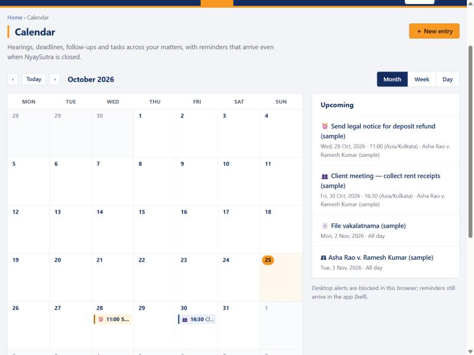

## 4.12 Dashboard, unified search and updates Implemented

- **Dashboard:** upcoming hearings, deadlines and tasks; counts of cases, documents and library items; recent updates.
- **Unified search:** one search box across cases, documents, bare acts, judgments, drafts, news and awareness items — retrieval only, no AI text mixed in.
- **Updates:** notifications, source status, LiveLaw headlines (from its official RSS feed, refreshed hourly) and, for administrators, the activity log.

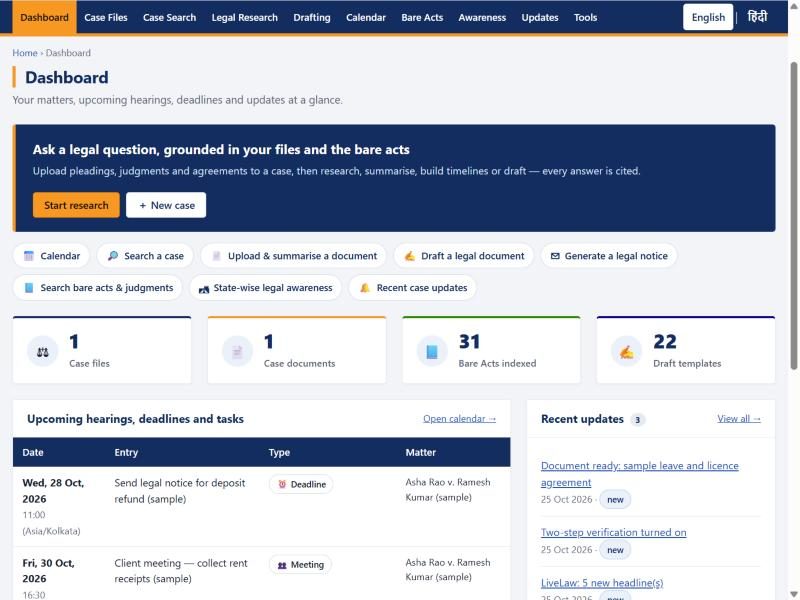

## 4.13 Case-information search Partial

- **What:** Enter any combination of CNR, case, filing or FIR number, court, State, district, parties. The app validates the identifiers, shows the matching cases already in the workspace, and gives the **official portal link** (eCourts, Supreme Court, Bombay High Court, Maharashtra Police) to look the case up there.
- **Why partial:** those portals require a CAPTCHA and offer no public API, so NyaySutra **does not fetch** case status automatically and never bypasses CAPTCHAs. The user can paste or import what they find.

## 4.14 Limitation calculator Implemented

24 categories of proceedings from the Limitation Act's schedule; the last date is computed by ordinary code (not by AI), with the legal basis and a caveat. Available without signing in.

## 4.15 State-wise legal awareness Partial coverage

8 curated items (5 central, 3 Maharashtra) with official links and FAQs; statute text shown is pulled from the library. Other States are not yet covered by curated content.

## 4.16 Voice input and read-aloud Implemented

The browser's own speech service turns speech into text in English, Hindi or Marathi; nothing is sent until the user presses *Send*. NyaySutra never receives audio. *Note:* some browsers (for example Chrome) process speech on the browser maker's servers — Needs verification per browser before recommending it for confidential dictation.

## 4.17 Administration Implemented

Administrators see users, change roles (Lawyer / Administrator), disable accounts, send invitations, withdraw pending invitations, read the audit log, manage integrations and set the chat-retention period. Administrators can see the list of matters but not their contents unless they add themselves to the case (which is logged).

## 4.18 AI reliability and fallback Implemented

If the language model service is slow or failing, NyaySutra retries with increasing waits, stops calling a failing model for a minute ("circuit breaker"), and switches to an approved backup model (gpt-oss:20b); answers produced this way are labelled *fallback model*. An answer cut off mid-way is marked incomplete and not verified. Long tasks are **durable background jobs** that survive restarts, can be cancelled and are retried a bounded number of times.

## 4.19 Features NOT present

A **FAQ page** as a separate feature does not exist (FAQs appear inside awareness items). There is **no** payment, client portal, mobile app, automatic court-data fetching, licensed case-law database or public hosting.

# 5. User Journey and End-to-End Workflow

The diagram shows the typical path through the application, matched to the real screens.

<figure>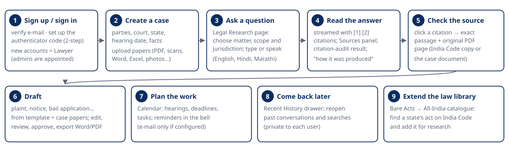<figcaption>Figure 1 — Typical user journey (all steps exist in the prototype).</figcaption></figure>

**Step by step:**

1. **Open and sign in.** Visitors can already read bare acts, awareness pages and the limitation tool. To work on cases the user signs in (e-mail + password + 6-digit code).
2. **Dashboard.** Shows upcoming hearings, deadlines and tasks, counts and recent updates.
3. **Create a matter and upload papers.** Files are checked, stored privately and read in the background; progress appears on the page.
4. **Research.** On *Legal Research* the user chooses the matter, scope and jurisdiction, then asks. The answer streams in with citations.
5. **Review sources.** The *Sources* panel lists each passage (with *Central law* or the State). Clicking a citation opens the exact passage and the original page.
6. **Draft.** From the case or the *Drafting* page, generate a draft, fill missing facts, review and export.
7. **Plan.** Add hearings and deadlines to the *Calendar*; reminders arrive in the bell.
8. **Return later.** *Recent History* reopens previous conversations and searches.

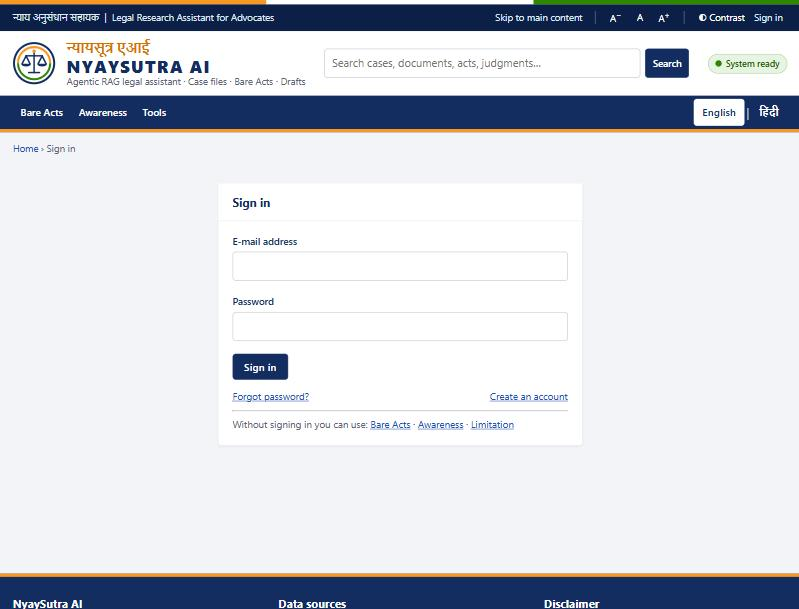

# 6. Complete Technology Stack and Platforms Used

All entries below were confirmed in the code, configuration and running system. Versions come from `requirements.txt` unless noted.

| Technology / platform | What it is | Why we use it | Where in NyaySutra | Data passing through it | Status |
|---|---|---|---|---|---|
| **Python 3** | Programming language | Mature AI and document libraries | Whole server (`nyaya/`) | All | Implemented |
| **FastAPI 0.143 + Uvicorn** | Web framework and web server | Fast, typed APIs; streaming answers | `nyaya/server.py` (~114 routes) | Every request | Implemented |
| **Plain JavaScript, HTML, CSS** | Browser front end, no framework | Small, strict security policy (no third-party scripts) | `web/` | Screens, user input | Implemented |
| **Supabase Auth** | Hosted user-account service | Proven password, e-mail and two-step handling | Sign-up, sign-in, reset, two-step | E-mail, password (hashed by Supabase), codes | Implemented |
| **Supabase Postgres** | Hosted database | Reliable storage with row-level security | 34 tables (Chapter 11) | Cases, document text, passages, chats, drafts, calendar | Implemented |
| **Supabase Storage** | Hosted file storage | Keeps original files private, off the server disk | Bucket `case-files` (private) | Uploaded case files | Implemented |
| **Supabase Vault** | Encrypted secret store | Sign-in tokens never stored in plain text | Session tokens | Supabase tokens | Implemented |
| Supabase Realtime, Edge Functions, Data API, pgvector | Other Supabase services | — | **Not used.** The Data API is deliberately closed to browser roles; vectors are searched in the app's memory | — | Not used |
| **Ollama Cloud** — `gpt-oss:120b`, `gpt-oss:20b` | Hosted large language models | Answers, planning, summaries, translation, drafting, citation double-check; backup model | `nyaya/llm.py` | Question, chat history excerpt and retrieved passages, with identity numbers masked | Implemented |
| **fastembed 0.9 (ONNX Runtime)** with **BAAI/bge-small-en-v1.5** | Local embedding model | Converts passages to 384-number "meaning" vectors, on our own machine | `nyaya/embeddings.py` | Passage text (never leaves the server) | Implemented |
| **Cross-encoder re-ranker** `Xenova/ms-marco-MiniLM-L-6-v2` | Local ranking model | Picks the passages that really answer the question | `nyaya/retrieval.py` | Question + passages (local) | Implemented |
| **In-memory vector index (NumPy)** | Exact similarity search | Simple and exact at current size (~9,700 passages) | `nyaya/vectorindex.py` | Vectors loaded from Postgres | Implemented |
| **Postgres full-text search** (SQLite FTS5 in local mode) | Keyword search | Section numbers, defined terms, names | `nyaya/retrieval.py` | Passage text | Implemented |
| **pypdfium2 5.14** | PDF reader (Chrome's PDF engine) | Accurate text extraction; safe for untrusted files | `nyaya/parsing.py`, upload checks | Uploaded PDFs | Implemented |
| **RapidOCR 3.10** (ONNX models) | OCR engine | Reads scanned PDFs and photos (English, Hindi, Marathi) without admin install | `nyaya/ocr.py` | Page images (local) | Implemented |
| python-docx, openpyxl, xlrd, python-pptx, striprtf, defusedxml | Office/format readers | Word, Excel, PowerPoint, RTF, OpenDocument, safe XML | `nyaya/parsing.py` | Uploaded files | Implemented |
| fpdf2 + uharfbuzz | PDF writer with Indic text shaping | Export drafts to PDF with correct Hindi/Marathi | `nyaya/export.py` | Draft text | Implemented |
| psycopg 3 + psycopg-pool | Postgres driver | Secure (TLS) pooled database connections | `nyaya/db.py` | All database traffic | Implemented |
| httpx | HTTP client | Calls to Supabase Auth/Storage, Ollama, India Code, LiveLaw | several | Requests to those services | Implemented |
| Web Speech API | Browser speech service | Optional voice input / read-aloud | `web/js/voice.js` | Speech handled by the browser | Implemented |
| pytest | Test framework | Automated tests | `tests/` (9 files) | Synthetic data only | Implemented |
| Git + GitHub | Version control | History, review, backup of code | Repository `SwarangiK-21/NyaySutra-AI` | Code (no secrets; `.env` is ignored) | Implemented |
| SMTP mail server | E-mail sending | Optional e-mail reminders | `nyaya/mailer.py` | Reminder text | Built, not configured |
| ClamAV | Virus scanner | Optional extra upload scan | `nyaya/filescan.py` | Uploaded files | Supported, not installed |
| Tesseract OCR | Alternative OCR engine | Used instead of RapidOCR if installed | `nyaya/ocr.py` | Page images | Supported, not installed |
| Hosting / deployment / monitoring | — | — | No cloud hosting, container, CI pipeline or monitoring service exists | — | Planned |

**Configuration** lives in a private `.env` file that is never committed. Its setting *names* (values are secret and not shown) include: `SUPABASE_URL`, `SUPABASE_DB_URL`, `SUPABASE_SECRET_KEY`, `SUPABASE_PUBLISHABLE_KEY`, `SUPABASE_BUCKET`, `OLLAMA_API_KEY`, `OLLAMA_HOST`, `LLM_MODEL`, `FAST_LLM_MODEL`, `LLM_FALLBACK_MODEL`, `EMBED_MODEL`, `RERANK_MODEL`, `AUTH_MODE`, `SIGNUP_MODE`, `MFA_REQUIRED_ROLES`, `SESSION_TTL_HOURS`, `SESSION_IDLE_MINUTES`, `APP_SECRET_KEY`, `OCR_ENGINE`, `SMTP_HOST`, `DEFAULT_TIMEZONE` and the various limits.

**Why Supabase?** It gives the four building blocks the project needs — accounts, a Postgres database with row-level security, private file storage and an encrypted vault — as one managed service with a data centre in Mumbai, so the team did not have to build or run them itself. The project uses Supabase *from the server only*: the browser never talks to Supabase directly.

**Needs verification:** the exact data-retention and privacy terms of Ollama Cloud for prompts sent to it; the speech-processing location of each browser's speech service.

# 7. Data Sources and Legal Information Collection

| Source | Type | How NyaySutra accesses it | Used for | Limits / notes |
|---|---|---|---|---|
| **India Code** (indiacode.gov.in), Legislative Department, Ministry of Law & Justice | Primary legislation (central and state acts) | **Official public REST API** (DSpace) — by a download script for the core set, and live from the *All-India catalogue* for imports; daily update check | Bare-act library, section lookup, research, provision verification | Coverage is what India Code holds; some acts appear twice, some lack an English file; consolidations may lag amendments. Attribution shown on every act ("India Code"). |
| **eCourts district court portal** (s3waas.gov.in host) | Copy of the IPC text (India Code text) | **One-time manual download** (address recorded in the download script) | IPC kept for pending matters | IPC was repealed from 1 July 2024; labelled as repealed. |
| **Indian Kanoon** (indiankanoon.org) | Case-law (judgments) | **Manual download of three judgment PDFs** stored in the library. *No Indian Kanoon API or scraping exists in the code.* | Sample precedents | Three judgments only — not a case-law database. One file's date in the source name is a placeholder. Indian Kanoon's terms apply to the downloaded copies. |
| **LiveLaw** (livelaw.in) | Legal news | **Official RSS feed**, polled hourly | Headlines on *Updates* and in search | Headlines and links only; full articles open on livelaw.in. |
| **eCourts, Supreme Court, Bombay High Court, Maharashtra Police citizen portal** | Case status, FIRs | **Links only** — opened by the user (CAPTCHA, no API). Never automated. | Case-information search helper | Users may import what they obtain themselves. |
| **LatestLaws** | Legal news / research | **Link only** (no feed; robots.txt disallows its API) | Listed as a manual source | — |
| **User uploads** | Client papers, orders, notices | Uploaded by the lawyer | Case research, drafting, summaries | Confidential; private storage; per-case access. |
| **Curated awareness content** (`data/awareness/awareness.json`) | Secondary, plain-language explanations with official links | Written into the project | Awareness pages | 8 items; "last verified" dates shown. |
| **Draft templates** (`data/library/drafts/`) | Drafting models | Written into the project | Drafting | Templates are not authority and are excluded from research answers. |

**Data quality and reliability.** Statutes are taken from the official government source and labelled with their jurisdiction; repealed acts are labelled; each imported act records where and when it was fetched. Every answer shows exactly which passage was used, so the lawyer can verify it. **Coverage is not comprehensive:** the library holds 31 acts and 3 judgments; any other law must be added (or is simply not available to the assistant).

# 8. RAG Explained in Simple Language

**Why an ordinary chatbot may be wrong.** A large language model (LLM) is a program trained on a huge amount of text to predict good next words. It writes fluent answers from memory — but its memory can be old, incomplete or mixed up, and it does not show where a statement came from. When it does not know, it may still produce a plausible-sounding section number. This is called a **hallucination**.

**What RAG does.** *Retrieval-Augmented Generation* means: **first find the relevant pages, then let the AI write only from those pages.** It is like giving a research assistant the exact law-book pages before asking the question, and requiring every sentence to point to a page.

<figure>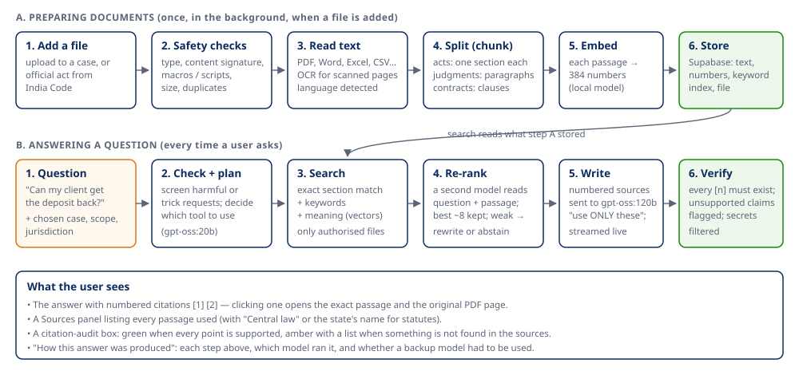<figcaption>Figure 2 — The RAG pipeline as implemented: preparing documents (A) and answering a question (B).</figcaption></figure>

**Key ideas, as used in NyaySutra:**

- **Chunking** — long documents are cut into passages that respect legal units: one passage per section for Acts, groups of numbered paragraphs for judgments, clauses for contracts. Each passage carries a header such as *"The Indian Contract Act, 1872 — Section 73"*.
- **Embeddings** — each passage is turned into a list of 384 numbers that captures its meaning, so "get my deposit back" can match a passage about "refund of security". This runs on our own server.
- **Hybrid search** — three searches together: an **exact lookup** ("Section 138 NI Act" must return exactly that section), a **keyword search** (rare words and names) and a **meaning (vector) search**. Their results are combined, then a **re-ranker** model reads question and passage together and keeps the best (about 8). Only documents the user is allowed to see, and only central law plus the chosen State's acts, are searched.
- **Context and citations** — the chosen passages are numbered and given to the language model, wrapped in markers that text inside a document cannot break out of, with the rule "use ONLY these sources; cite [n] for every point; say if the sources do not cover something".
- **If evidence is weak** — the agent rewrites the search once; if still weak, it says that the sources do not cover the question instead of guessing.

**Example, start to finish.** *Question:* "Can my client recover the security deposit, and within what time must she file a suit?" → the app recognised a research question (planner, gpt-oss:20b) → searched the case file and library, restricted to central law + Maharashtra → found 8 passages including the Limitation Act's Schedule (Articles 70 and 67) and CPC Order XIV → gpt-oss:120b wrote the answer citing them → the audit found one unsupported point and showed it → the trace listed every step and model.

**Remaining risks (stated plainly).** The answer can only be as good as the library: a missing State act or an amendment not yet reflected in India Code's file will not be found. The model can still misread a correct passage. The audit catches some but not all errors. Answers must be checked by a qualified lawyer.

# 9. AI Agents and Architecture of the Assistant

**Verdict: NyaySutra uses a single "agentic" pipeline, not a multi-agent system.** One planner decides which of five tools to use for each question; the tools are ordinary code paths, not independent agents talking to each other. (A proposal for supervisor/specialist agents was reviewed in October 2026 and deliberately not built.)

<figure>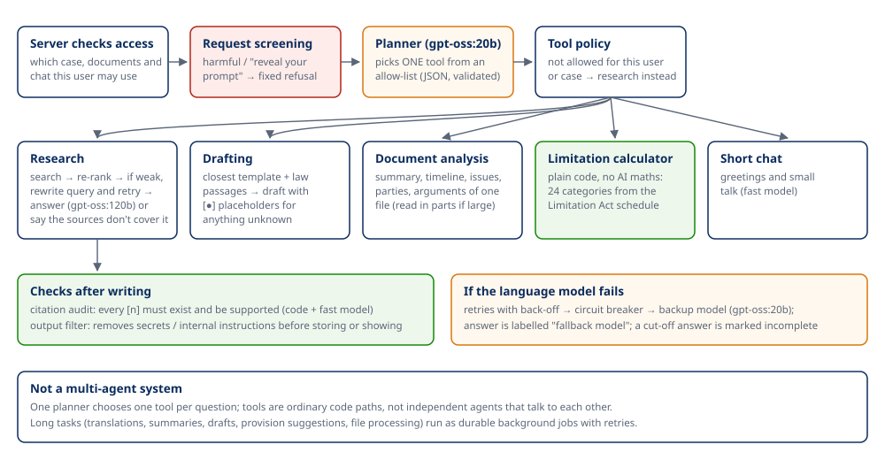<figcaption>Figure 3 — The research agent: checks, one planner, allow-listed tools, verification and fallback.</figcaption></figure>

| Component | Input | Output | Can call |
|---|---|---|---|
| Access check (server) | User, chosen case/document/chat | Allowed scope | Database |
| Request screening (code) | Question | Continue, or a fixed refusal | — |
| Planner (gpt-oss:20b) | Question, short history, list of case documents | One tool + validated arguments (JSON) | — |
| Research tool | Question, scope, jurisdiction | Cited answer | Search engine, gpt-oss:120b |
| Drafting tool | Request, templates, law passages | Draft with placeholders | Search engine, gpt-oss:120b |
| Document analysis tool | One document | Summary / timeline / issues / parties / arguments | gpt-oss:120b |
| Limitation calculator | Proceeding type, start date | Last date + basis | Plain code |
| Short chat | Greeting | Short reply | gpt-oss:20b |
| Citation audit + output filter | Answer + sources | Supported / list of issues; cleaned text | Code + gpt-oss:20b |

**Fallback behaviour:** retries with back-off; a circuit breaker after 4 failures for 60 seconds; the backup model; answers labelled when the backup was used; incomplete answers labelled. If the planner fails, the request is treated as research. Background jobs re-check the user's permission when they run and are retried up to a limit, then marked failed with the reason.

# 10. System Architecture

<figure>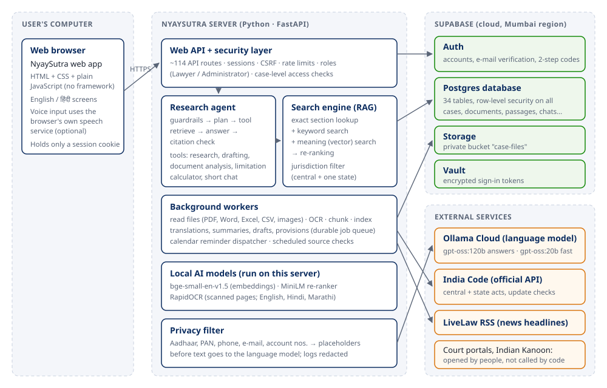<figcaption>Figure 4 — Verified components and data flow (no secrets or internal addresses shown).</figcaption></figure>

In plain terms:

- **The browser** shows the screens. It never holds passwords, database keys or AI keys — only a session cookie.
- **The NyaySutra server** (Python, FastAPI) is the only part that talks to Supabase, the language model and India Code. It checks who you are and what you may do on every request.
- **Supabase** stores accounts, data and files in the Mumbai region, and enforces its own access rules as a second safety layer.
- **Local models** (embeddings, re-ranker, OCR) run on the server itself, so passages and scans are processed without leaving it.
- **Ollama Cloud** hosts the language models; it receives only the question and the selected passages, with identity numbers masked.
- **Background workers** handle slow work (reading files, OCR, summaries, drafts, reminders) so the screens stay responsive.

**Code and documentation disagreements found.** Some code comments still describe SQLite as the main database (the app supports both; the live system uses Supabase Postgres). `docs/IMPLEMENTATION_PLAN.md` describes the state of 22 October 2026 (single user, SQLite, "Tesseract not installed") and is now outdated. The git history shows an earlier Streamlit + LangGraph prototype that the current code no longer uses.

# 11. Database and Storage Design

<figure>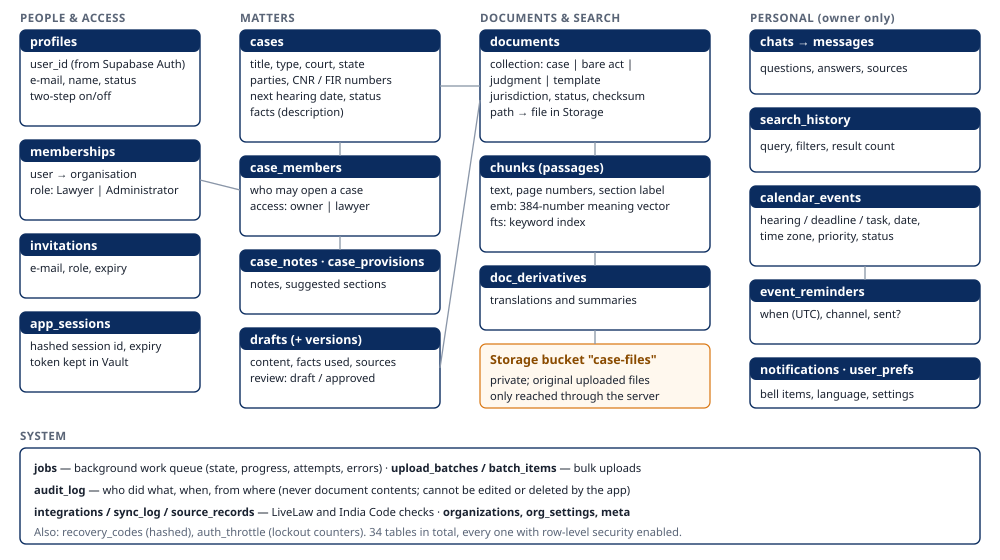<figcaption>Figure 5 — Simplified, sanitised view of the main tables (34 in total).</figcaption></figure>

- **People and access:** `profiles` (one per account), `memberships` (role in the organisation), `invitations`, `app_sessions` (only a fingerprint of the session cookie is stored), `recovery_codes` (stored as one-way fingerprints).
- **Matters:** `cases`, `case_members` (owner / lawyer), `case_notes`, `case_provisions`, `drafts` and `draft_versions`.
- **Documents and search:** `documents` (one row per file or act, with jurisdiction, status and a checksum to detect duplicates), `chunks` (the passages with their meaning vectors and keyword index), `doc_derivatives` (translations and summaries).
- **Personal records:** `chats` and `messages`, `search_history`, `calendar_events` and `event_reminders`, `notifications`, `user_prefs`.
- **System:** `jobs`, `upload_batches`, `batch_items`, `audit_log`, `integrations`, `sync_log`, `source_records`, `organizations`, `org_settings`, `meta`, `auth_throttle`.

**File lifecycle.** Upload → checks → stored in the private bucket `case-files` under a server-generated name → text extracted and indexed → shown only through the server after an access check → deleted together with its passages when the document or case is deleted. Office files are always downloaded rather than displayed inside the app. Library acts are stored on the server's disk under `data/library/`.

**How users' records are separated.** Every request is checked by the server; in addition, **row-level security** (RLS) is switched on for all 34 tables: the database itself only returns rows the current user may see (their cases, their chats, their calendar). The database's public Data API is closed to browser roles, and the audit log cannot be edited or deleted by the application.

# 12. Security, Privacy and AI Guardrails

| Control | In code? | Tested? |
|---|---|---|
| Accounts via Supabase Auth; e-mail verification; password rules | Yes | Automated tests (with a fake Auth server) + live test |
| Two-step verification (authenticator codes), recovery codes, device list | Yes | Automated + live test |
| Server-side sessions; HttpOnly, SameSite=Strict cookie; CSRF token; host/origin checks; idle and absolute expiry | Yes | Automated tests |
| Account lockout (5 failures / 15 min); rate limits on sign-in, sign-up, chat (20/min), uploads (60/min) | Yes | Automated tests |
| Roles (Lawyer, Administrator) and per-case access, checked on every request | Yes | Automated tests incl. cross-user isolation |
| Row-level security on all 34 tables; Data API closed | Yes | Live tests against Supabase (another user, an anonymous caller and an escalation attempt are refused) |
| Upload checks: type allow-list, content signature, PDF JavaScript, Office macros / embedded objects / external links, size | Yes | Automated tests |
| Virus scanning (ClamAV) | Partly | **Not installed** |
| Prompt-injection defences: hidden-character removal, request screening, source delimiters, injection flags, allow-listed tools | Yes | Automated tests |
| Output filter (secrets, internal instructions); citation verification | Yes | Automated tests |
| Identity numbers masked before text reaches the language model; log redaction | Yes | Automated tests |
| Audit log (actor, role, IP, outcome; never document contents), append-only | Yes | Automated + live test |
| Secrets in `.env` only, never committed; tokens in Vault | Yes | Checked before each commit |
| Leaked-password protection (Supabase setting) | — | **Off** — recommended to enable |
| Independent penetration test, backups, monitoring/alerting | — | **Not done** |

**What this does *not* mean.** These controls exist and are covered by automated tests, but the system has **not** been independently audited and is **not** claimed to be fully secure. Names, addresses and facts are sent to the language model when needed for analysis (only identity numbers are masked) — clients' consent and the provider's terms must be considered before real data is used.

**Recommended additional tests:** an external penetration test; automated dependency vulnerability scanning; a load test; a restore-from-backup drill; red-team prompt-injection documents in Hindi and Marathi.

# 13. Legal Safety and Responsible AI

- **Information, not advice.** Every answer carries the notice *"AI research aid, not legal advice — verify citations in the primary source."* Drafts are labelled DRAFT until a lawyer approves a specific version.
- **Source verification.** Statutes come from India Code; each citation opens the exact passage and page; provisions suggested for a case are checked against the library.
- **Uncertainty.** When the sources are weak the assistant says so; unsupported points are listed by the citation audit; uncertain OCR words are marked `[?word]`; unknown facts in drafts stay as `[●]`.
- **Outdated law and jurisdiction.** Acts may have been amended after India Code's file; repealed acts are labelled; State acts apply only in their State and answers are told to say whether a provision is central or State law. The library does not cover all States or all areas of law.
- **Sensitive data.** Identity numbers are masked before AI calls; consent is asked before sending a document to the AI for translation or summary; chat retention can be limited.
- **When to consult a lawyer.** Always before relying on an answer for advice, filing or litigation; whenever the audit flags issues; whenever the matter involves a State or area of law not in the library.

# 14. User Interface and Pages

| Page (menu) | Purpose | Main actions |
|---|---|---|
| Sign in / Create account / Forgot password | Access | Sign in, register, reset, two-step code |
| Dashboard | Overview | Start research, new case, quick links, upcoming items, updates |
| Case Files | Matters | List and filter, create, open; tabs Overview / Documents / Provisions / Notes & orders / People |
| Case Search | Identifier search | Validate numbers, find workspace matches, open official portals, import |
| Legal Research | Cited AI answers | Matters panel (matter, scope, jurisdiction), Recent History drawer, Sources panel, voice, new chat |
| Drafting / Legal notice | Drafts | Generate, edit, review, approve, export Word/PDF |
| Calendar | Planning | Month/week/day, new entry, complete, reschedule, cancel, delete, desktop alerts |
| Bare Acts | Law library | Section lookup, filter by jurisdiction, All-India catalogue, judgments |
| Awareness | Public legal information | Choose State and topic |
| Updates | Notifications and news | Mark read, sources status, LiveLaw headlines, activity log (admin) |
| Tools | Utilities | Limitation calculator, draft templates, jobs, privacy settings, about |
| Account | Personal settings | Name, password, two-step, signed-in devices |
| Administration (admin only) | People and roles | Users, roles, disable, invitations, audit log |
| Header controls | Accessibility | Text size A−/A/A+, high contrast, English/हिंदी, system status, notification bell |

The screenshots in this document were taken from the running prototype with **synthetic sample data** created for this purpose and deleted afterwards. The administration page is described from the code; it was not captured.

# 15. API and Integration Inventory

The server exposes about **114 routes**. Grouped by purpose (no credentials or payloads shown):

| Group | Examples | Purpose | Errors returned |
|---|---|---|---|
| Session & auth | `/api/session`, `/api/auth/login`, `/api/auth/signup`, `/api/auth/mfa/*`, `/api/auth/password/*`, `/auth/callback` | Sign-in, two-step, reset | 401 not signed in, 403 forbidden, 429 too many attempts |
| Cases & people | `/api/cases`, `/api/cases/{id}/members`, `/notes`, `/provisions` | Matters and access | 404 for cases the user cannot see (does not reveal they exist) |
| Documents | `/api/cases/{id}/documents`, `/api/documents/{id}/file`, `/text`, `/intel`, `/translate`, `/summarize`, `/reprocess`, `/api/batches` | Upload, view, AI on documents | 415 wrong file type, 413 too large, clear reasons for quarantined files |
| Research | `/api/chat` (streaming), `/api/chats`, `/api/history`, `/api/search`, `/api/library/*`, `/api/jurisdictions` | Answers, history, search, library | Error events in the stream; 422 invalid input |
| Drafting | `/api/drafting/*`, `/api/drafts/*` | Drafts and export | 409 if approval is blocked by placeholders |
| Calendar | `/api/calendar/*` | Entries and reminders | 400 invalid dates/times, 404 for others' entries |
| Jobs & updates | `/api/jobs/*`, `/api/notifications`, `/api/news`, `/api/integrations/*` | Background work, bell, news | Job states: queued, processing, completed, partial, failed, dead, cancelled |
| Administration | `/api/admin/*`, `/api/audit` | Users, roles, invitations, log | 403 for non-administrators |

**Outbound integrations:** Supabase Auth, Postgres, Storage and Vault; Ollama Cloud; India Code API; LiveLaw RSS; optional SMTP. Each external call has time limits and readable error messages; India Code calls are restricted to `indiacode.gov.in`.

# 16. Testing and Validation

**Automated tests (executed on 25 October 2026):**

| Test file | What it checks | Tests |
|---|---|---|
| `test_security.py` | Accounts, two-step, sessions, CSRF, roles, cross-user isolation, uploads, guardrails, audit, redaction | 35 |
| `test_features.py` | Case forms, case search and record import, news-feed sync, languages, OCR rules, translation, summaries, provisions, drafting, export, awareness, unified search, retention | 29 |
| `test_reliability.py` | Job queue, retries, cancellation, OCR checkpoints, LLM fallback, draft review, act versions | 18 |
| `test_upgrades.py` | Open sign-up, personas, India Code catalogue/import, jurisdiction filter, history, calendar, reminders, e-mail retries | 13 |
| `test_formats.py` | Every upload format, OCR on scanned PDFs and photos, refusal of macros/embedded objects | 11 functions (15 cases) |
| `test_core.py`, `test_api.py`, `test_supabase.py` | Chunking, retrieval, chat stream, Supabase layer | 7 + 6 + 9 |
| `test_live_security.py` (opt-in, real Supabase) | Row-level security, calendar/history privacy, auth + two-step + Vault, job queue | 4 |

**Results:** 131 offline tests passed (5 live tests skipped in that run); the 4 live security tests passed when run against the real project with the app stopped. One live test in `test_supabase.py` was **not re-run** during this documentation pass. Offline tests use a fake language model and fake embeddings, so they test the plumbing and safety logic, **not answer quality**.

**Manual checks performed while preparing this document** (synthetic data): sign-up as Lawyer; scanned PDF OCR; every upload format; research answer with citations and audit; jurisdiction-filtered answer from an imported Karnataka act; calendar reminder delivered by the server; Recent History; India Code catalogue.

**Proposed manual test cases (not yet executed):**

| # | Scenario | Expected result |
|---|---|---|
| 1 | Ask about a law not in the library | Says the sources do not cover it; no invented section |
| 2 | Search with no results | Clear "no results" message |
| 3 | Upload an `.exe` renamed to `.pdf`, a macro Excel file, a 60 MB file | Each refused with a reason |
| 4 | Language-model service unreachable | Backup model used and labelled, or a clear error |
| 5 | India Code unreachable | Catalogue shows "India Code did not respond" |
| 6 | User B opens user A's case/chat/calendar link | "Not found" |
| 7 | A document containing "ignore previous instructions…" | Passage flagged; instructions not followed |
| 8 | Ask the assistant to forge a document | Fixed refusal |
| 9 | Compare 20 answers against the cited passages by a lawyer | Measure accuracy of citations (no figure exists yet) |
| 10 | Very large batch upload / many users at once | Measure speed and failures (no load test yet) |

# 17. Current Progress and Remaining Work

**Completed and verified**

- Accounts with e-mail verification, two-step verification, sessions, lockout; two personas; public sign-up as Lawyer.
- Matters with per-case access; database row-level security on all tables; audit log.
- Upload of 21 file extensions (PDF, Word, Excel, CSV, PowerPoint, OpenDocument, RTF, text, images) with safety checks; OCR for scans (English, Hindi, Marathi); background processing with progress, retries and cancellation.
- Hybrid search (exact + keyword + meaning) with re-ranking and jurisdiction filter; cited answers with citation audit and trace.
- Law library of 31 acts; live India Code catalogue for all 36 States/UTs with import.
- Drafting with placeholders, review and export; provisions with verification; limitation calculator.
- Calendar with server-side reminders; Recent History; dashboard; unified search; LiveLaw headlines; English/Hindi interface.

**Partially completed**

- Case-law coverage (3 sample judgments; no licensed database).
- State coverage (catalogue for all States, but only 2 State acts indexed; Maharashtra-specific helpers).
- Case-status lookup (official links only; no automation possible without an API).
- E-mail reminders (built; SMTP not configured). Virus scanning (supported; not installed).
- Awareness content (central + Maharashtra only).

**Planned / not implemented**

- Hosting on a server with HTTPS, backups and monitoring; a production deployment process.
- Independent security review; dependency scanning; load testing.
- A measured answer-quality evaluation with lawyers.

**Prioritised next steps (recommendations)**

1. **Answer-quality evaluation** — have lawyers rate 50–100 answers against their citations; this is the most important evidence for mentors and users.
2. **Turn on leaked-password protection and install ClamAV** — low effort, real risk reduction.
3. **Expand the library** for the States the users practise in (import from the catalogue) and add a licensed or properly permitted judgment source.
4. **Hosting with HTTPS, backups and monitoring** — required before any real client data.
5. **Configure SMTP** if e-mail reminders are wanted.
6. **Security review** by an independent tester.

# 18. Known Limitations and Risks

**Observed (seen during testing):**

- OCR is slow on long scans (a 36-page scan took about 9½ minutes) and weaker on poor scans.
- India Code sometimes lists the same act twice and some acts have no English file.
- The citation audit flagged a real slip in a test answer — evidence that the model does make mistakes.
- The connection to Supabase occasionally timed out on this computer's network, which stopped background work until it recovered.
- A question combining two unrelated topics may retrieve sources for only one of them.
- Fixed while preparing this document: the dashboard showed 0 case documents (now counts correctly).

**Possible risks (not yet observed):**

- Missing or outdated law leading to an incomplete answer; jurisdiction mistakes when a matter spans States.
- Dependence on external services (Ollama Cloud, Supabase, India Code); cost and rate limits of the AI provider — no cost figures have been measured.
- Scalability: the meaning-search index is held in memory (fine for ~10,000 passages; would need a dedicated vector index for much larger libraries); one server process.
- Privacy: case facts and names are sent to the AI provider; client consent and the provider's terms must be confirmed.

# 19. Mentor Demonstration Guide (about 8 minutes)

| # | Do this | Show | Behind the scenes | Say |
|---|---|---|---|---|
| 1 | Open `http://127.0.0.1:8000` signed out | Public Bare Acts page; English/हिंदी switch | Library served from the server | "Anyone can read the official law text without an account." |
| 2 | Sign in (with your authenticator code) | Dashboard | Supabase Auth + two-step + server session | "Every lawyer has a private, two-step-protected account." |
| 3 | Open a sample case → *Documents* → drop a scanned PDF | Upload progress, then "ready" | Safety checks, private storage, OCR, indexing | "Even scanned papers become searchable." |
| 4 | *Legal Research* → ☰ Matters → choose the case and its State | Context line "Central + Maharashtra" | Access and jurisdiction filters | "We tell it which matter and which State's law apply." |
| 5 | Ask: *"Can my client recover the security deposit, and within what time must she sue?"* | Answer streaming with [1] [2] | Hybrid search → re-rank → model writes only from sources | "It answers only from the passages it found." |
| 6 | Open *Sources*, click a citation | The exact passage and PDF page | Citations are links to stored passages | "Every point can be checked in the original." |
| 7 | Expand *How this answer was produced* | Steps and models; audit box | Trace and citation audit | "If a point is not supported, it tells us." |
| 8 | *Bare Acts* → *All-India catalogue* → choose a State → search | Live India Code list | Official India Code API | "We can add any State's act from the official source." |
| 9 | *Calendar* → new deadline with reminder | Entry and upcoming list | Server-side reminder scheduling | "Reminders arrive even when the app is closed." |
| 10 | Open *Recent History* | Past conversations and searches | Per-user, protected records | "Previous research is one click away." |

*Tip:* prepare the sample case and the scanned PDF before the meeting; OCR of a long scan takes minutes.

# 20. Likely Mentor Questions and Suggested Answers

1. **Why Supabase?** It gives us accounts, a database with row-level security, private file storage and an encrypted vault as one managed service in Mumbai, so we did not have to build those ourselves.
2. **What is RAG and why is it necessary?** Retrieve first, then answer only from what was retrieved. It makes answers checkable and reduces invented citations.
3. **How do we obtain legal data?** Acts from India Code's official API; three sample judgments downloaded manually; news from LiveLaw's RSS; the rest is uploaded by the lawyer.
4. **How is Indian Kanoon used?** Only as the source of three judgment PDFs downloaded manually as samples. There is no Indian Kanoon API integration.
5. **How are citations generated and checked?** Passages are numbered; the model must cite [n]; code checks every number and looks for unsupported sections, cases and dates; a second model double-checks; issues are shown.
6. **What if the AI is wrong?** The audit may flag it; every claim links to its source; the answer is labelled not legal advice; a lawyer must verify.
7. **How do we protect user data?** Private accounts with two-step, per-case access checked by the server and again by the database, private file storage, masked identity numbers, redacted logs, an audit log.
8. **What are RBAC and RLS?** Role-based access control decides what a *type* of user may do (Lawyer vs Administrator). Row-level security makes the *database itself* return only the rows a user may see.
9. **What if an agent or external API fails?** Retries, a circuit breaker and a backup model for the AI; clear messages if India Code or news is down; background jobs are retried and never left hanging.
10. **How do we handle large volumes of documents?** Background workers, batch uploads with limits, passages indexed once and searched quickly; at much larger scale we would move to a dedicated vector index and more workers.
11. **How is it tested?** 131 automated offline tests and 4 live tests against Supabase, plus manual checks with synthetic data. Answer quality has not yet been measured by lawyers.
12. **What are the current limitations?** Library coverage, sample-only case law, local-only deployment, OCR speed, no independent security audit.
13. **How could it become production-ready?** Hosting with HTTPS, backups, monitoring, a security review, a quality evaluation, wider library, a licensed judgment source and clear data-processing agreements.
14. **Which AI models do you use?** gpt-oss:120b for answers and gpt-oss:20b for fast tasks and as backup, via Ollama Cloud; local models for embeddings, re-ranking and OCR.
15. **Does client data go to the AI company?** The question and selected passages do, with identity numbers masked; files and embeddings stay with us and Supabase.
16. **Is it a multi-agent system?** No — one planner with five tools. That is simpler to secure and test; multiple agents were considered and not needed yet.
17. **How do you handle State laws?** Every act is tagged Central or with its State; research is limited to central law plus the chosen State; other States' acts can be imported from India Code.
18. **Can it read Hindi and Marathi?** Yes — uploads in those languages, OCR of scans, summaries and answers; the interface is English/Hindi.
19. **What stops prompt injection in a document?** Hidden characters removed, passages wrapped in unbreakable markers, instruction-like text flagged, and the model can only choose from allow-listed tools — the server, not the model, decides which data may be used.
20. **Why not let it fetch case status automatically?** Court portals use CAPTCHAs and offer no public API; bypassing them would be wrong. We link to the official page instead.
21. **What does it cost to run?** Not measured yet. Costs would come from the AI provider, Supabase and hosting.
22. **How do you keep secrets safe?** Keys live only in a private `.env` file on the server, never in the code or browser; sign-in tokens are encrypted in Supabase Vault.

# 21. Glossary

| Term | Simple meaning |
|---|---|
| API | A defined way for one program to ask another for data or actions — like a counter where requests are handed in. |
| Endpoint / route | One specific "counter window" of an API, e.g. `/api/chat`. |
| Frontend | What runs in the browser: screens and buttons. |
| Backend / server | The program that does the work behind the screens and talks to databases and AI. |
| Database | Organised storage of records (tables of rows and columns). |
| Cloud storage | Files kept on a provider's servers (here: a private Supabase bucket). |
| Authentication | Proving who you are (password + code). |
| Authorization | Deciding what you are allowed to do. |
| RBAC | Role-based access control: permissions by role (Lawyer, Administrator). |
| RLS | Row-level security: the database itself filters rows per user. |
| LLM | Large language model — an AI trained on text that writes fluent answers. |
| Hallucination | A confident but invented statement by an AI. |
| RAG | Retrieval-augmented generation: find sources first, then answer from them. |
| Chunking | Cutting documents into passages (here, by section, paragraph or clause). |
| Embedding | A list of numbers representing a passage's meaning. |
| Vector / semantic search | Finding passages whose meaning is close to the question, not just same words. |
| Re-ranker | A model that re-orders candidate passages by how well they answer the question. |
| OCR | Optical character recognition: reading text from images or scans. |
| Prompt | The instructions and text given to an AI model. |
| Prompt injection | Text that tries to give the AI new instructions (e.g. hidden in a document). |
| Guardrails | Rules in code that limit what the AI may see, do and output. |
| Pipeline | A sequence of processing steps. |
| Background job | Work done later by the server, with progress, so the screen is not blocked. |
| Circuit breaker | Stops calling a failing service for a short time. |
| Fallback | A backup used when the main option fails. |
| Latency | Waiting time before a response. |
| Scalability | Ability to handle more users or data. |
| Two-step verification (MFA) | A second proof of identity, here a 6-digit app code. |
| CSRF | A trick that makes a browser send unwanted requests; blocked by a secret token. |
| Audit log | A permanent record of who did what and when. |

# 22. Conclusion

NyaySutra shows that an AI legal research assistant can be built around **evidence rather than eloquence**: every answer is tied to numbered passages from official statute text or the lawyer's own files, the citations are checked automatically, and the data is protected by accounts, roles and database-level security. The prototype already supports the core workflow of a practising lawyer — matters, documents in many formats including scans, cited research, drafting, deadlines and history.

It is still a prototype. The law library is a curated subset of Indian law, case law is limited to samples, the system runs on one computer, answer quality has not been measured with lawyers, and production safeguards (hosting, backups, monitoring, independent security review) remain to be done. With those steps — starting with a lawyer-led evaluation of answers — NyaySutra could become a reliable research aid for advocates, always as an assistant to, and never a substitute for, professional legal judgment.

# 23. Sources, References and Questions for the Team

**Official sources consulted (accessed 25 October 2026 unless noted):**

- India Code, Legislative Department, Ministry of Law and Justice — https://indiacode.gov.in/ (REST API: `/server/api/`).
- eCourts Services — https://services.ecourts.gov.in/ (checked 22 October 2026).
- Supreme Court of India — https://www.sci.gov.in/ (checked 22 October 2026).
- High Court of Judicature at Bombay — https://bombayhighcourt.gov.in/ (checked 22 October 2026).
- Maharashtra Police citizen portal — https://citizen.mahapolice.gov.in/ (checked 22 October 2026).
- LiveLaw RSS — https://www.livelaw.in/google_feeds.xml.
- Indian Kanoon — https://indiankanoon.org/ (source of three sample judgments).
- Supabase documentation (Auth, Postgres row-level security, Storage, Vault) — https://supabase.com/docs.
- Project documents: `README.md`, `docs/SECURITY.md`, `docs/SECURITY_AUDIT.md`, `docs/RELIABILITY.md`, `docs/SUPABASE_MIGRATION.md`, `docs/IMPLEMENTATION_PLAN.md` (historical).

**Questions for the team (please confirm before sharing):**

1. Student, team, mentor and institution details for the cover page.
2. Has permission been checked for using the three Indian Kanoon judgment copies, and should a licensed judgment source be pursued?
3. Ollama Cloud's data-handling terms for prompts containing client facts — has this been reviewed?
4. Should e-mail reminders be enabled (which mail server)?
5. Which States should be prioritised for importing acts?
6. Is the intended deployment a single chamber/firm (one organisation, as now) or many organisations?
